# Threshold — Resultado da validação

Gerado por `analise/analisar.py` em 19/10/2026 16:59. Critérios definidos antes da coleta (docs/02-kit-de-validacao.md, seção "Como analisar").

## Amostra

| Grupo | Respostas válidas | Removidas |
| --- | --- | --- |
| Alunos | 39 | 1 sem consentimento |
| Professores | 7 | 0 sem consentimento, 1 nunca orientaram |

## Hipóteses

| # | Hipótese | Veredito | Evidência | Decisão de produto |
| --- | --- | --- | --- | --- |
| H1 | ABNT é uma das maiores dores | **Confirmada** | ABNT é a 2ª maior média da A3 (3,87 de 5); 28% escolheram ABNT como maior dificuldade na A4 (critério: top 3 OU ≥25%). | Revisor ABNT segue como fatia funcional. Pela A5, começar por: Citações (38%), Resumo e palavras-chave (36%). |
| H2 | Aluno não sabe o próximo passo | **Confirmada** | Média da A6 = 2,72 (critério < 3); top-2 da A12 = 64% (critério ≥ 60%). | Roadmap sobe para funcional no nível "se sobrar tempo". |
| H3 | Escolha de orientador sem informação | **Não confirmada** | Top-2 da A8 = 77% (critério < 50%). | Reduzir o perfil a uma vitrine simples. |
| H4 | IA que orienta é aceita | **Não confirmada** | Top-2 A11 = 59%; top-2 P7 = 14% (critério: os dois ≥ 60%). | Rever a proposta de IA com o orientador. |
| H5 | Professores aceitam o perfil | **Confirmada** | Top-2 P9 = 86% (critério ≥ 60%). | Perfil fica. Feedback agregado ENTRA (top-2 P10 = 100%, critério ≥ 60%). |
| H6 | Segurança pesa na decisão | **Não confirmada** | Top-2 A13 = 69%; top-2 P12 = 29% (critério: os dois ≥ 60%). | Segurança segue igual, mas com menos destaque na apresentação. |

## Respostas dos alunos

### A1. Em que momento do TCC você está?

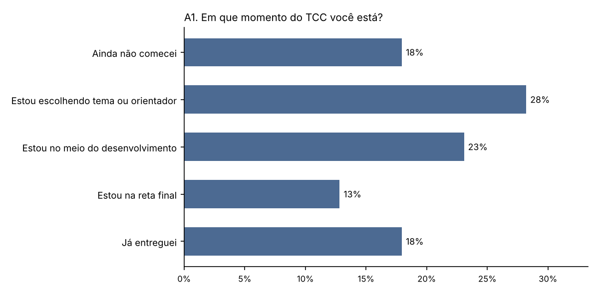

| Opção | Respostas | % |
| --- | --- | --- |
| Ainda não comecei | 7 | 18% |
| Estou escolhendo tema ou orientador | 11 | 28% |
| Estou no meio do desenvolvimento | 9 | 23% |
| Estou na reta final | 5 | 13% |
| Já entreguei | 7 | 18% |

n = 39

### A2. Qual a área do seu curso?

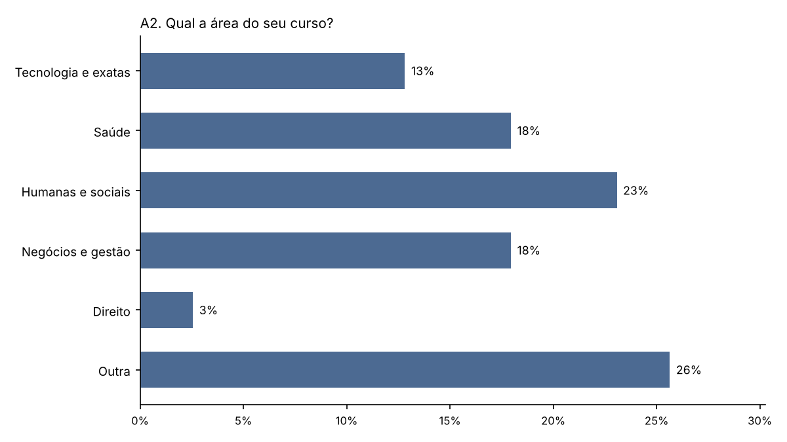

| Opção | Respostas | % |
| --- | --- | --- |
| Tecnologia e exatas | 5 | 13% |
| Saúde | 7 | 18% |
| Humanas e sociais | 9 | 23% |
| Negócios e gestão | 7 | 18% |
| Direito | 1 | 3% |
| Outra | 10 | 26% |

n = 39

### A3. Quanto cada item é (ou foi) difícil no seu TCC?

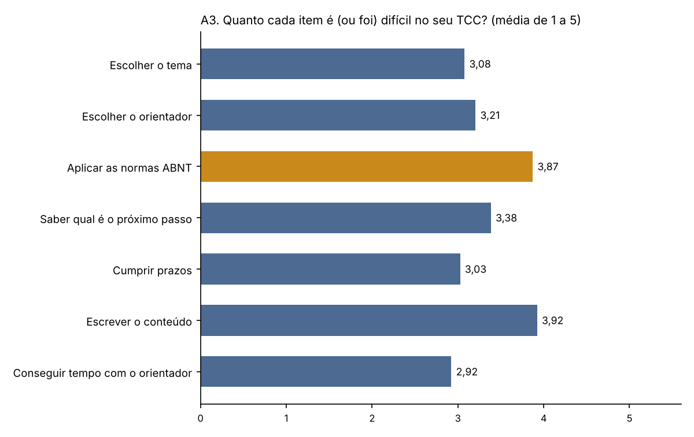

| Item | Média (1–5) | Notas 4–5 | n |
| --- | --- | --- | --- |
| Escrever o conteúdo | 3,92 | 72% | 39 |
| Aplicar as normas ABNT | 3,87 | 64% | 39 |
| Saber qual é o próximo passo | 3,38 | 44% | 39 |
| Escolher o orientador | 3,21 | 38% | 39 |
| Escolher o tema | 3,08 | 31% | 39 |
| Cumprir prazos | 3,03 | 36% | 39 |
| Conseguir tempo com o orientador | 2,92 | 23% | 39 |

### A4. Desses itens, qual é a sua MAIOR dificuldade?

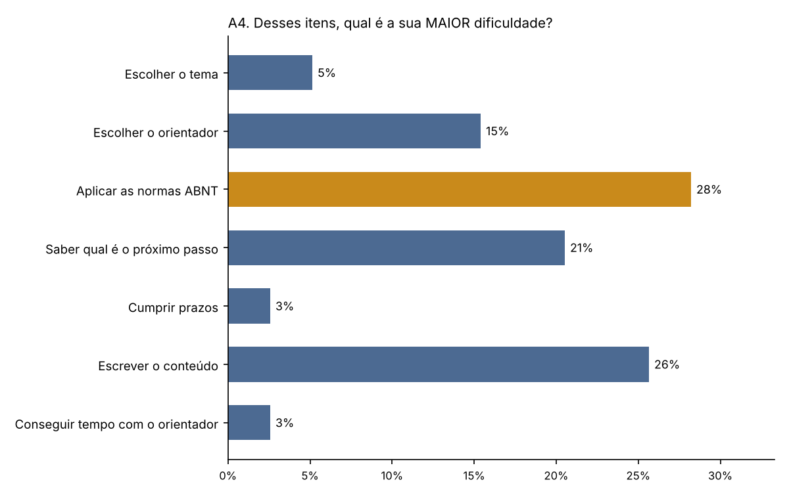

| Opção | Respostas | % |
| --- | --- | --- |
| Escolher o tema | 2 | 5% |
| Escolher o orientador | 6 | 15% |
| Aplicar as normas ABNT | 11 | 28% |
| Saber qual é o próximo passo | 8 | 21% |
| Cumprir prazos | 1 | 3% |
| Escrever o conteúdo | 10 | 26% |
| Conseguir tempo com o orientador | 1 | 3% |

n = 39

### A5. Nas normas ABNT, o que mais dá trabalho?

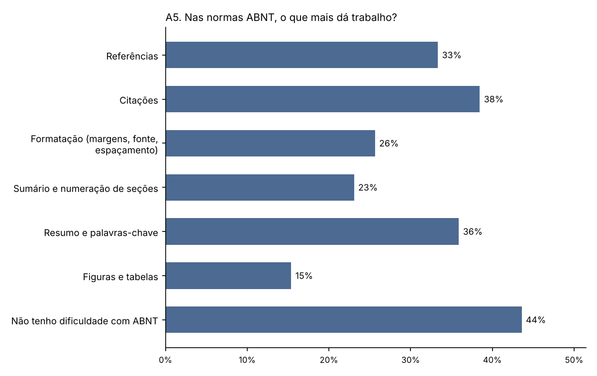

| Opção | Respostas | % |
| --- | --- | --- |
| Referências | 13 | 33% |
| Citações | 15 | 38% |
| Formatação (margens, fonte, espaçamento) | 10 | 26% |
| Sumário e numeração de seções | 9 | 23% |
| Resumo e palavras-chave | 14 | 36% |
| Figuras e tabelas | 6 | 15% |
| Não tenho dificuldade com ABNT | 17 | 44% |

n = 39 (cada pessoa podia marcar várias; a soma passa de 100%)

### A6. Você sabe quais são as etapas do seu TCC e o prazo de cada uma?

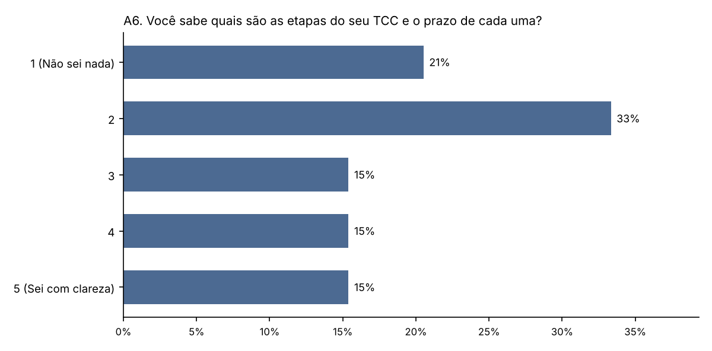

| Nota | Respostas |
| --- | --- |
| 1 | 8 |
| 2 | 13 |
| 3 | 6 |
| 4 | 6 |
| 5 | 6 |

n = 39 · média = **2,72** · notas 4–5 = 31%

### A7. Como você escolheu (ou pretende escolher) seu orientador?

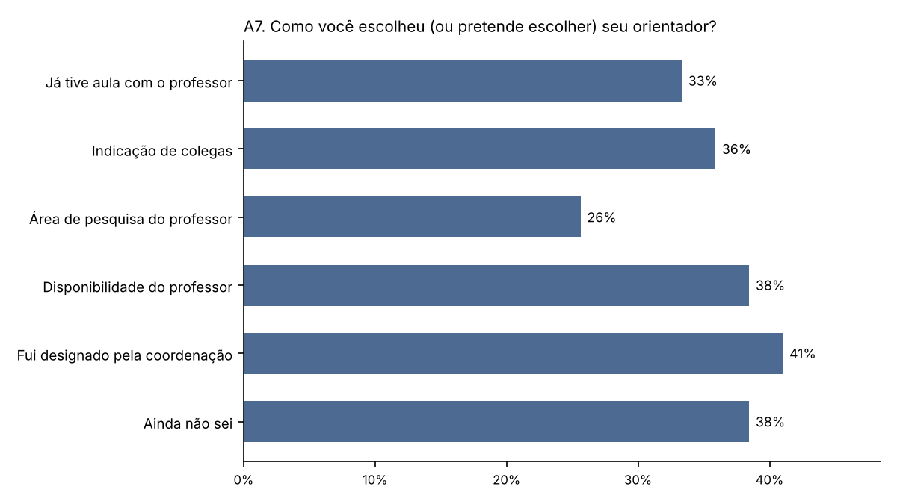

| Opção | Respostas | % |
| --- | --- | --- |
| Já tive aula com o professor | 13 | 33% |
| Indicação de colegas | 14 | 36% |
| Área de pesquisa do professor | 10 | 26% |
| Disponibilidade do professor | 15 | 38% |
| Fui designado pela coordenação | 16 | 41% |
| Ainda não sei | 15 | 38% |

n = 39 (cada pessoa podia marcar várias; a soma passa de 100%)

### A8. "Tenho (ou tive) informação suficiente para escolher bem meu orientador."

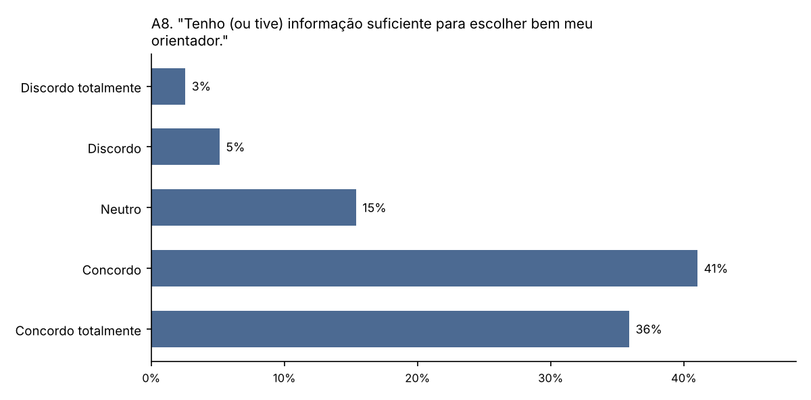

| Opção | Respostas | % |
| --- | --- | --- |
| Discordo totalmente | 1 | 3% |
| Discordo | 2 | 5% |
| Neutro | 6 | 15% |
| Concordo | 16 | 41% |
| Concordo totalmente | 14 | 36% |

n = 39 · top-2 (Concordo + Concordo totalmente) = **77%**

### A9. O que você gostaria de saber sobre um professor antes de escolhê-lo?

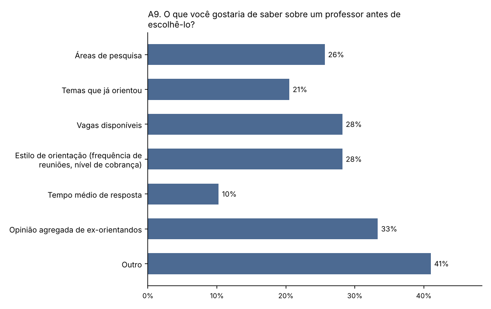

| Opção | Respostas | % |
| --- | --- | --- |
| Áreas de pesquisa | 10 | 26% |
| Temas que já orientou | 8 | 21% |
| Vagas disponíveis | 11 | 28% |
| Estilo de orientação (frequência de reuniões, nível de cobrança) | 11 | 28% |
| Tempo médio de resposta | 4 | 10% |
| Opinião agregada de ex-orientandos | 13 | 33% |
| Outro | 16 | 41% |

n = 39 (cada pessoa podia marcar várias; a soma passa de 100%)

Texto livre: "se ele responde e-mail"

### A10. Você já usou IA (ChatGPT, Gemini, Claude etc.) em trabalhos acadêmicos?

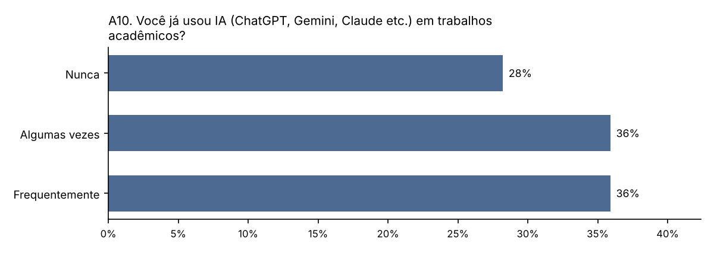

| Opção | Respostas | % |
| --- | --- | --- |
| Nunca | 11 | 28% |
| Algumas vezes | 14 | 36% |
| Frequentemente | 14 | 36% |

n = 39

### A11. "Eu usaria uma IA que aponta erros de ABNT e explica a correção, mas não escreve o texto por mim."

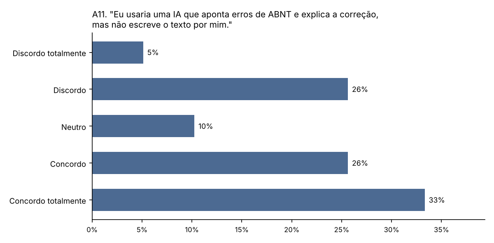

| Opção | Respostas | % |
| --- | --- | --- |
| Discordo totalmente | 2 | 5% |
| Discordo | 10 | 26% |
| Neutro | 4 | 10% |
| Concordo | 10 | 26% |
| Concordo totalmente | 13 | 33% |

n = 39 · top-2 (Concordo + Concordo totalmente) = **59%**

### A12. "Eu usaria uma ferramenta que mostra as próximas etapas do meu TCC."

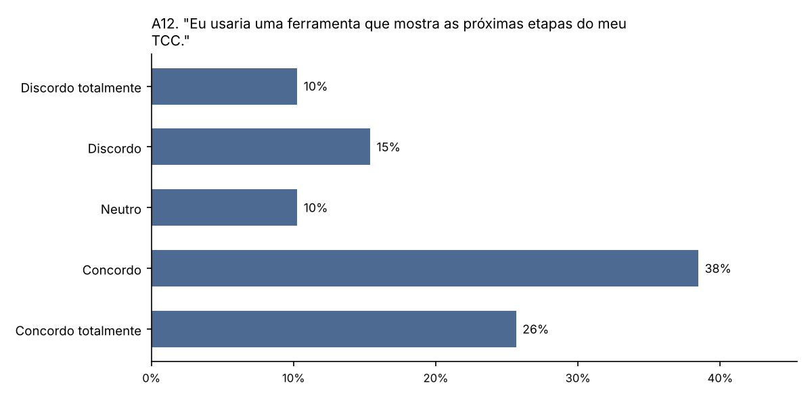

| Opção | Respostas | % |
| --- | --- | --- |
| Discordo totalmente | 4 | 10% |
| Discordo | 6 | 15% |
| Neutro | 4 | 10% |
| Concordo | 15 | 38% |
| Concordo totalmente | 10 | 26% |

n = 39 · top-2 (Concordo + Concordo totalmente) = **64%**

### A13. "Saber como meus dados são protegidos influencia minha decisão de usar uma plataforma."

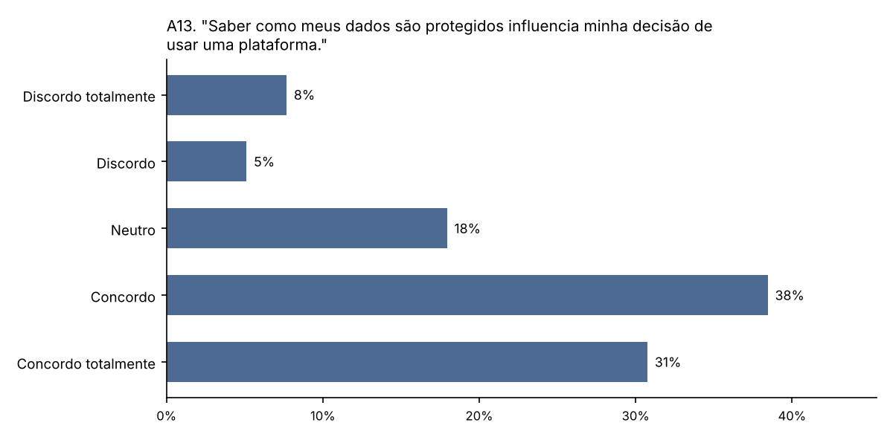

| Opção | Respostas | % |
| --- | --- | --- |
| Discordo totalmente | 3 | 8% |
| Discordo | 2 | 5% |
| Neutro | 7 | 18% |
| Concordo | 15 | 38% |
| Concordo totalmente | 12 | 31% |

n = 39 · top-2 (Concordo + Concordo totalmente) = **69%**

### A14. Quais informações você se sentiria confortável em colocar numa plataforma de TCC?

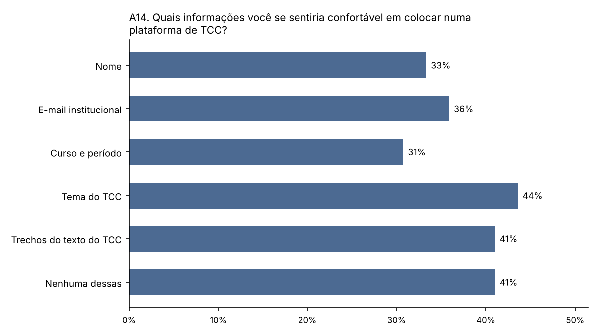

| Opção | Respostas | % |
| --- | --- | --- |
| Nome | 13 | 33% |
| E-mail institucional | 14 | 36% |
| Curso e período | 12 | 31% |
| Tema do TCC | 17 | 44% |
| Trechos do texto do TCC | 16 | 41% |
| Nenhuma dessas | 16 | 41% |

n = 39 (cada pessoa podia marcar várias; a soma passa de 100%)

## Respostas dos professores

### P1. Você orienta ou já orientou TCC?

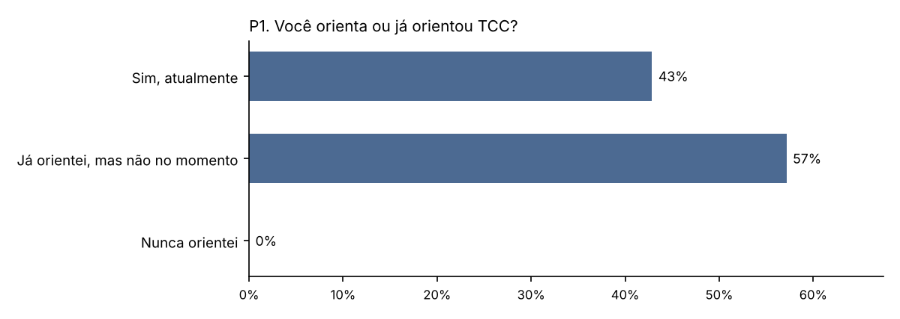

| Opção | Respostas | % |
| --- | --- | --- |
| Sim, atualmente | 3 | 43% |
| Já orientei, mas não no momento | 4 | 57% |
| Nunca orientei | 0 | 0% |

n = 7

### P2. Quantos orientandos de TCC você acompanha por semestre, em média?

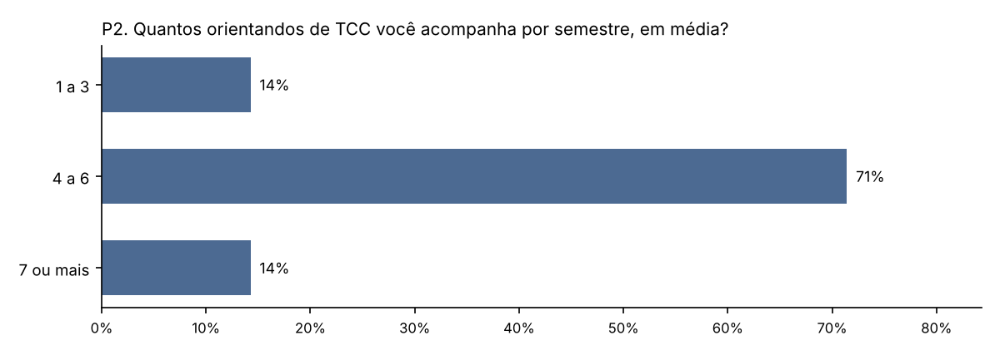

| Opção | Respostas | % |
| --- | --- | --- |
| 1 a 3 | 1 | 14% |
| 4 a 6 | 5 | 71% |
| 7 ou mais | 1 | 14% |

n = 7

### P3. Quanto cada item consome do seu tempo de orientação?

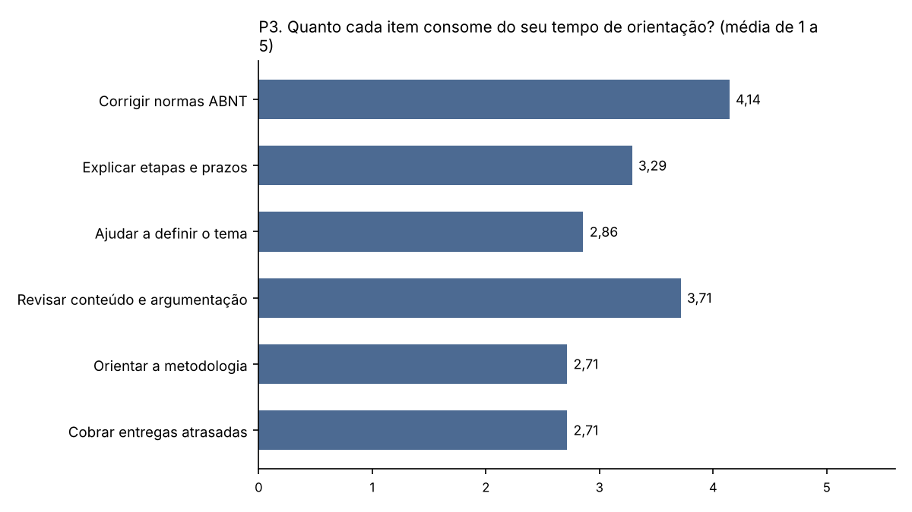

| Item | Média (1–5) | Notas 4–5 | n |
| --- | --- | --- | --- |
| Corrigir normas ABNT | 4,14 | 86% | 7 |
| Revisar conteúdo e argumentação | 3,71 | 43% | 7 |
| Explicar etapas e prazos | 3,29 | 43% | 7 |
| Ajudar a definir o tema | 2,86 | 0% | 7 |
| Orientar a metodologia | 2,71 | 43% | 7 |
| Cobrar entregas atrasadas | 2,71 | 14% | 7 |

### P4. Em qual desses itens você gostaria de gastar MENOS tempo?

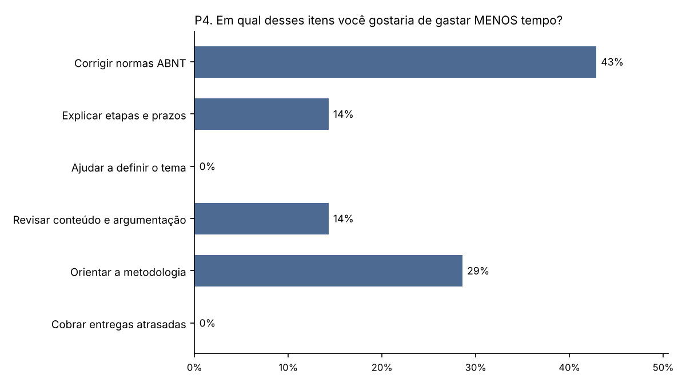

| Opção | Respostas | % |
| --- | --- | --- |
| Corrigir normas ABNT | 3 | 43% |
| Explicar etapas e prazos | 1 | 14% |
| Ajudar a definir o tema | 0 | 0% |
| Revisar conteúdo e argumentação | 1 | 14% |
| Orientar a metodologia | 2 | 29% |
| Cobrar entregas atrasadas | 0 | 0% |

n = 7

### P5. "Os alunos chegam ao TCC sabendo aplicar as normas ABNT."

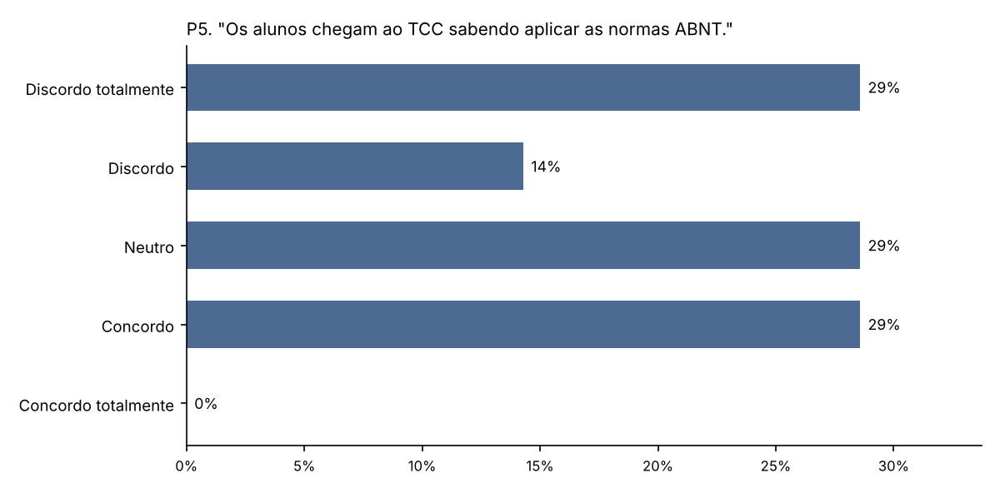

| Opção | Respostas | % |
| --- | --- | --- |
| Discordo totalmente | 2 | 29% |
| Discordo | 1 | 14% |
| Neutro | 2 | 29% |
| Concordo | 2 | 29% |
| Concordo totalmente | 0 | 0% |

n = 7 · top-2 (Concordo + Concordo totalmente) = **29%**

### P6. "Os alunos escolhem o orientador pela afinidade com o tema."

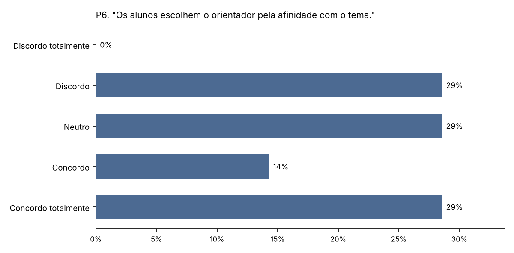

| Opção | Respostas | % |
| --- | --- | --- |
| Discordo totalmente | 0 | 0% |
| Discordo | 2 | 29% |
| Neutro | 2 | 29% |
| Concordo | 1 | 14% |
| Concordo totalmente | 2 | 29% |

n = 7 · top-2 (Concordo + Concordo totalmente) = **43%**

### P7. "Eu recomendaria aos meus orientandos uma IA que aponta erros de ABNT e explica a correção, sem escrever o texto."

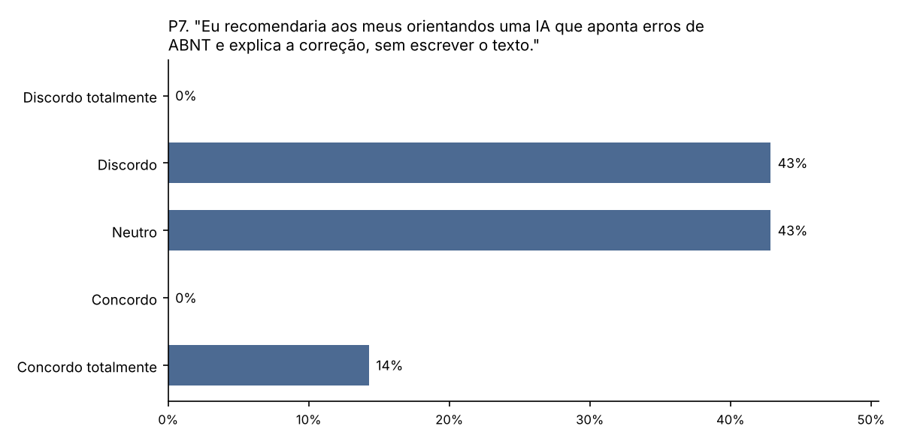

| Opção | Respostas | % |
| --- | --- | --- |
| Discordo totalmente | 0 | 0% |
| Discordo | 3 | 43% |
| Neutro | 3 | 43% |
| Concordo | 0 | 0% |
| Concordo totalmente | 1 | 14% |

n = 7 · top-2 (Concordo + Concordo totalmente) = **14%**

### P8. Qual sua maior preocupação com o uso de IA pelos alunos no TCC?

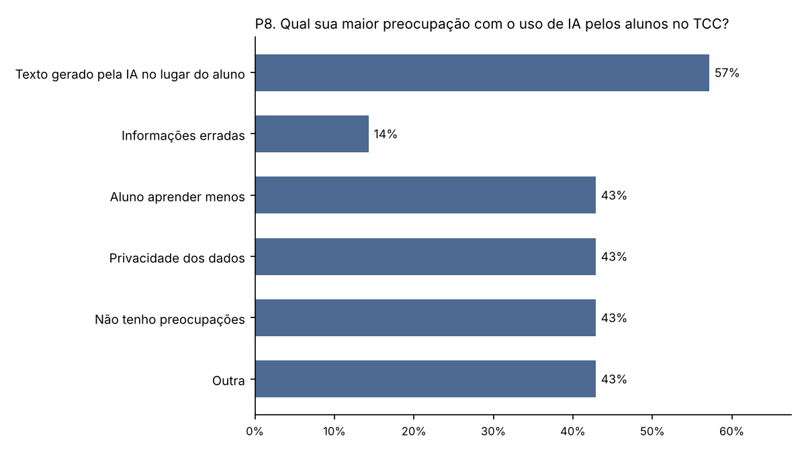

| Opção | Respostas | % |
| --- | --- | --- |
| Texto gerado pela IA no lugar do aluno | 4 | 57% |
| Informações erradas | 1 | 14% |
| Aluno aprender menos | 3 | 43% |
| Privacidade dos dados | 3 | 43% |
| Não tenho preocupações | 3 | 43% |
| Outra | 3 | 43% |

n = 7 (cada pessoa podia marcar várias; a soma passa de 100%)

### P9. "Eu aceitaria ter um perfil de afinidade na plataforma, preenchido por mim."

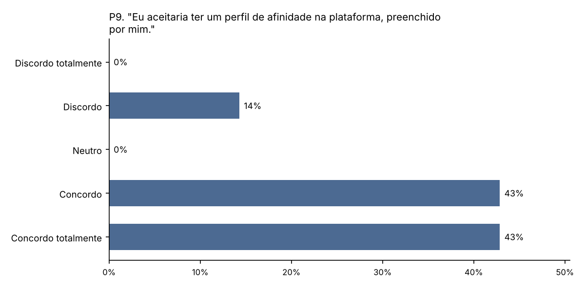

| Opção | Respostas | % |
| --- | --- | --- |
| Discordo totalmente | 0 | 0% |
| Discordo | 1 | 14% |
| Neutro | 0 | 0% |
| Concordo | 3 | 43% |
| Concordo totalmente | 3 | 43% |

n = 7 · top-2 (Concordo + Concordo totalmente) = **86%**

### P10. "Eu aceitaria que meu perfil mostrasse um resumo anônimo e agregado da opinião de ex-orientandos, moderado e exibido só a partir de 5 avaliações."

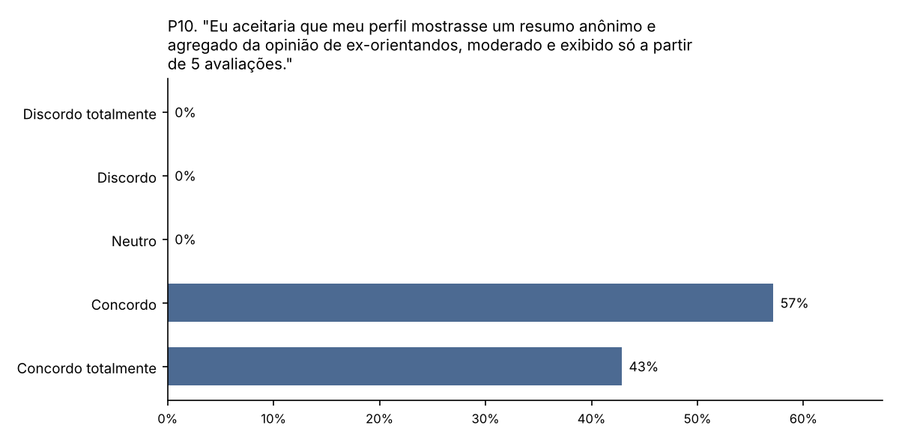

| Opção | Respostas | % |
| --- | --- | --- |
| Discordo totalmente | 0 | 0% |
| Discordo | 0 | 0% |
| Neutro | 0 | 0% |
| Concordo | 4 | 57% |
| Concordo totalmente | 3 | 43% |

n = 7 · top-2 (Concordo + Concordo totalmente) = **100%**

### P11. O que você colocaria no seu perfil?

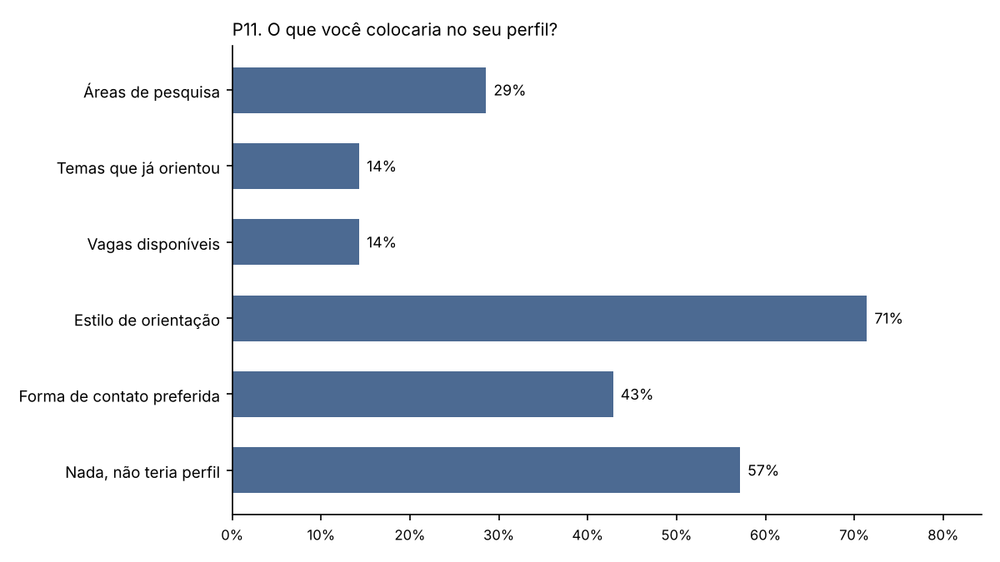

| Opção | Respostas | % |
| --- | --- | --- |
| Áreas de pesquisa | 2 | 29% |
| Temas que já orientou | 1 | 14% |
| Vagas disponíveis | 1 | 14% |
| Estilo de orientação | 5 | 71% |
| Forma de contato preferida | 3 | 43% |
| Nada, não teria perfil | 4 | 57% |

n = 7 (cada pessoa podia marcar várias; a soma passa de 100%)

### P12. "A segurança dos dados dos alunos é decisiva para eu apoiar uma plataforma como essa."

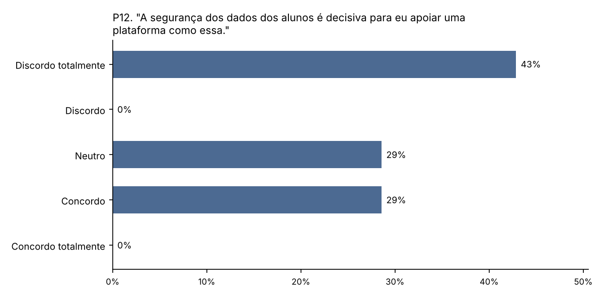

| Opção | Respostas | % |
| --- | --- | --- |
| Discordo totalmente | 3 | 43% |
| Discordo | 0 | 0% |
| Neutro | 2 | 29% |
| Concordo | 2 | 29% |
| Concordo totalmente | 0 | 0% |

n = 7 · top-2 (Concordo + Concordo totalmente) = **29%**

## Anexo: respostas abertas

Lista completa para o mapa de afinidade (agrupar por tema à mão). Antes de citar no TCC, confira se nenhuma resposta identifica alguém.

### A15. Se uma plataforma pudesse resolver UMA coisa no seu TCC, o que seria? (28 respostas)

1. Revisar as referências, que sempre volta com correção.
2. Um lugar que diga o que falta em cada etapa.
3. Revisar as referências, que sempre volta com correção.
4. Revisar as referências, que sempre volta com correção.
5. Saber antes quem orienta qual tema.
6. Revisar as referências, que sempre volta com correção.
7. Saber antes quem orienta qual tema.
8. Um lugar que diga o que falta em cada etapa.
9. Um lugar que diga o que falta em cada etapa.
10. Um lugar que diga o que falta em cada etapa.
11. Um lugar que diga o que falta em cada etapa.
12. Saber antes quem orienta qual tema.
13. Um lugar que diga o que falta em cada etapa.
14. Saber antes quem orienta qual tema.
15. Um lugar que diga o que falta em cada etapa.
16. Um lugar que diga o que falta em cada etapa.
17. Um lugar que diga o que falta em cada etapa.
18. Revisar as referências, que sempre volta com correção.
19. Um lugar que diga o que falta em cada etapa.
20. Saber antes quem orienta qual tema.
21. Revisar as referências, que sempre volta com correção.
22. Revisar as referências, que sempre volta com correção.
23. Revisar as referências, que sempre volta com correção.
24. Revisar as referências, que sempre volta com correção.
25. Um lugar que diga o que falta em cada etapa.
26. Um lugar que diga o que falta em cada etapa.
27. Um lugar que diga o que falta em cada etapa.
28. Um lugar que diga o que falta em cada etapa.

### P13. O que mais ajudaria você a orientar TCCs? (4 respostas)

1. Revisar as referências, que sempre volta com correção.
2. Saber antes quem orienta qual tema.
3. Saber antes quem orienta qual tema.
4. Um lugar que diga o que falta em cada etapa.

## Ressalva

A amostra é de conveniência (divulgação em grupos de turma e convite a professores) e não representa toda a universidade. O resultado orienta decisões de produto e não permite generalizar.
