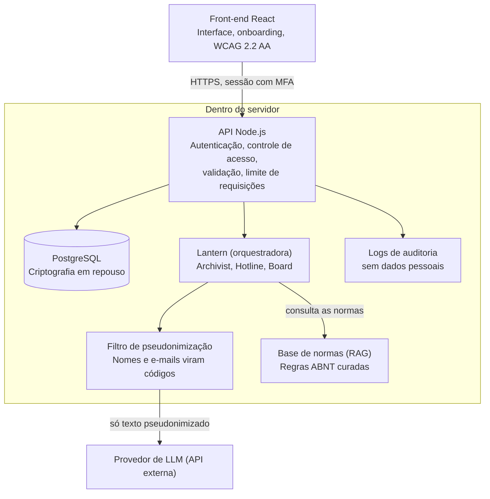
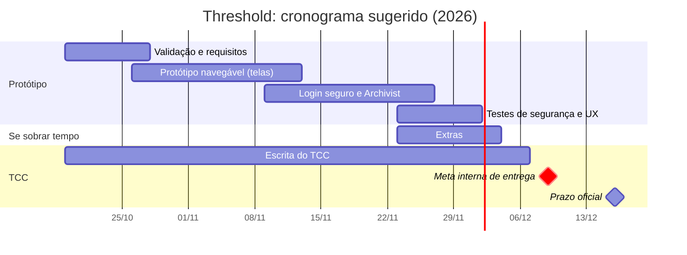

# Threshold — Documento de Visão

> Versão 0.5 · 14/11/2026 · Maximo Di Giorgio
> v0.5: escopo atualizado com o que foi construído até a v0.8 do código (7 salas funcionais). Decisão em aberto: login com MFA entra antes do congelamento ou vira trabalho futuro.
> v0.3: projeto renomeado de Black Box para Threshold; guia de IA batizada de Lantern.
> v0.2: escopo redefinido para protótipo primeiro; prazo oficial 16/12 e meta interna 09/12.
> Cópia versionada do documento vivo. Edições de conteúdo devem ser feitas primeiro no doc compartilhado e depois sincronizadas aqui.

## Sumário

1. [Resumo executivo](#resumo-executivo)
2. [Problema e justificativa](#problema-e-justificativa)
3. [Personas](#personas)
4. [Objetivos](#objetivos)
5. [Escopo: protótipo primeiro](#escopo-protótipo-primeiro)
6. [Funcionalidades e agentes de IA](#funcionalidades-e-agentes-de-ia)
7. [Match de orientadores](#match-de-orientadores)
8. [Segurança, privacidade e LGPD](#segurança-privacidade-e-lgpd)
9. [Identidade visual e experiência](#identidade-visual-e-experiência)
10. [Arquitetura e stack](#arquitetura-e-stack)
11. [Cronograma até o fim de 2026](#cronograma-até-o-fim-de-2026)
12. [Riscos e mitigação](#riscos-e-mitigação)
13. [Perguntas em aberto](#perguntas-em-aberto)
14. [Referências](#referências)

---

## Resumo executivo

O Threshold é uma plataforma web com agentes de IA que guia alunos do início ao fim do TCC e alivia a carga dos professores orientadores. Ela verifica normas ABNT, mostra ao aluno o próximo passo do trabalho e ajuda a escolher o orientador mais compatível com o tema.

**O nome:** *threshold* é "limiar" em inglês. O TCC é a passagem de aluno para profissional, e a palavra também evoca o clima de Control. Dentro da plataforma, os agentes de IA falam com o aluno por uma única guia, a **Lantern**, a lanterna que ilumina o próximo passo. O projeto se chamava Black Box até 16/10/2026 e mudou de nome porque já existe o BLACKBOX.AI, um assistente de programação com IA.

Três princípios guiam o projeto:

- **A IA orienta, não escreve.** Os agentes explicam, apontam e corrigem forma; o conteúdo continua sendo do aluno.
- **Fortaleza de dados.** A plataforma trata dados de pessoas reais e segue a LGPD desde o desenho (privacy by design).
- **Primeiro acesso sem medo.** Interface didática e acessível (WCAG 2.2 AA), com uma estética de "arquivo confidencial" que é atmosférica sem ser hostil.

Entrega: um protótipo, com meta interna em 9 de dezembro de 2026 e prazo oficial em 16 de dezembro. Stack: React + Node.js.

## Problema e justificativa

O TCC concentra muita formalidade num momento em que o aluno ainda está aprendendo a pesquisar, e quem absorve as dúvidas é o orientador. O Threshold ataca três dores:

| Dor | Quem sente | Como aparece hoje |
| --- | --- | --- |
| Normas ABNT difíceis de aplicar | Aluno e orientador | São várias normas ao mesmo tempo (trabalho, referências, citações, resumo, sumário). O orientador gasta reunião corrigindo forma em vez de conteúdo. |
| Falta de roteiro | Aluno | O aluno não sabe qual é a próxima etapa nem se está atrasado. |
| Escolha de orientador "no escuro" | Aluno e professor | A escolha acontece por indicação ou acaso. Tema e orientador ficam desalinhados, e a orientação rende menos. |

**Por que agora:** agentes de IA já conseguem revisar forma e estrutura com boa precisão. Sem regras claras, porém, o aluno usa IA genérica para escrever o trabalho, o que fere a integridade acadêmica. O Threshold oferece a versão ética: uma IA que ensina e confere, dentro de limites definidos pela instituição.

## Personas

Três perfis usam a plataforma, cada um com uma visão e permissões próprias.

| Persona | Quem é | O que precisa | O que vê e faz |
| --- | --- | --- | --- |
| **Aluna Ana, 7º período** | Vai começar o TCC e nunca formatou um trabalho em ABNT | Saber por onde começar, que orientador escolher e se o texto está nas normas | Roadmap do próprio TCC, agentes de IA, perfis de orientadores, envio de feedback anônimo |
| **Prof. Ricardo, orientador** | Orienta vários alunos ao mesmo tempo | Gastar menos tempo com forma e saber em que etapa cada orientando está | Painel dos orientandos, o próprio perfil de afinidade (editável por ele), resumo agregado dos feedbacks |
| **Coordenação de curso** | Responsável pelo processo de TCC | Acompanhar prazos e distribuição de orientandos sem acessar o conteúdo dos trabalhos | Indicadores agregados, cadastro de professores, moderação de feedbacks |

Um quarto perfil, **administrador do sistema**, existe só para operação técnica e não enxerga dados acadêmicos em texto claro.

As personas Ana e Ricardo são fictícias e devem ser validadas com alunos e professores reais.

## Objetivos

**Objetivo geral:** desenvolver uma plataforma web com agentes de IA que apoie alunos e orientadores no processo de TCC, com foco em conformidade com a ABNT, acompanhamento de etapas e escolha de orientador, garantindo proteção de dados pessoais conforme a LGPD.

**Objetivos específicos:**

1. Implementar um agente que verifique a conformidade de trechos do TCC com as normas ABNT e explique cada correção.
2. Criar um roadmap guiado das etapas do TCC, com checklist e progresso visível para aluno e orientador.
3. Desenvolver um sistema de afinidade entre aluno e orientador baseado em áreas de pesquisa e feedback agregado.
4. Aplicar privacy by design e os controles do OWASP Top 10 (web e LLM), validados por testes automatizados de segurança.
5. Entregar uma interface acessível (WCAG 2.2 AA) e avaliada com usuários em teste de usabilidade.

Cada objetivo específico tem um critério de aceite verificável, que será detalhado no documento de requisitos.

## Escopo: protótipo primeiro

A entrega garantida é um protótipo, e o resto entra em camadas conforme o tempo permitir. O prazo oficial é 16 de dezembro e a meta interna é 9 de dezembro, o que deixa cerca de 7 semanas úteis. O que não entrar vira "trabalhos futuros" no texto do TCC.

| Funcionalidade | No protótipo | Se sobrar tempo |
| --- | --- | --- |
| Login com MFA e perfis (aluno, professor, coordenação) | **Ainda não construído** na v0.8: a demonstração troca de perfil por um link, só com pessoas inventadas. **Decisão em aberto** (Maximo, Nicole e orientador): construir até o congelamento de 26/11 ou declarar como trabalho futuro | Em qualquer caso, é o primeiro item antes de dados reais |
| Onboarding guiado ("briefing") no primeiro acesso | Funcional, com mapa das salas | |
| Agente Archivist (revisor ABNT): referências (NBR 6023) | Funcional: na conversa e **em lote** (lista inteira), com busca por DOI e ISBN | Incluir citações (NBR 10520) |
| Roadmap de etapas do TCC com checklist | **Funcional** (v0.8), com dados fictícios guardados no servidor | Guardar no banco |
| Perfil de afinidade do orientador | **Funcional** (v0.8): pedido de orientação de ponta a ponta | Feedback moderado de ex-orientandos |
| Painel do orientador com orientandos | **Funcional** (v0.8): pedidos, devolutivas, revisão de etapa, lembrete | Guardar no banco |
| Relatório da fortaleza (incluído em 06/11/2026) | **Funcional** (v0.8): 12 verificações ao vivo e teste da tarja | Varredura OWASP ZAP |
| Agentes Hotline (etapas) e Board (orientação) | Demo funcional com IA real, sobre dados fictícios | Funcional, com dados do banco |
| Sala de Recorte do tema (incluída em 06/11/2026 a partir da validação) | Demo funcional com IA real | Salvar recortes no dossiê |
| Estrutura completa (NBR 14724), upload de .docx, painel da coordenação, integração acadêmica, app mobile | Fora | Fora (trabalhos futuros) |

**Por que essa fatia funcional:** o Archivist e a pseudonimização provam com código real os dois pilares mais difíceis, a IA ética e a fortaleza de dados, e a sala Fortaleza mostra essa proteção funcionando na frente da banca. O plano original punha o login com MFA nessa fatia. Na prática, o tempo foi para o fluxo completo aluna ↔ orientador, porque foi o que a validação pediu: os professores querem gastar menos tempo com ABNT, etapas e cobrança de atraso. Enquanto não houver login, a plataforma **não pode receber dados reais**, e isso está escrito no `SECURITY.md` e na própria sala Fortaleza. Se o login ficar para trabalhos futuros, a banca precisa ouvir essa justificativa.

## Funcionalidades e agentes de IA

Cada agente tem uma tarefa estreita, uma lista de ferramentas limitada e nunca recebe dados pessoais que não precisa. Agentes especializados são mais fáceis de testar e de defender na banca do que um único "chat que faz tudo".

Para o aluno, os três agentes aparecem como uma só guia, a **Lantern**: ele conversa com ela, e o agente certo responde por trás. Cada resposta mostra um selo discreto ("via Archivist") para o aluno saber quem respondeu.

Os nomes seguem o clima de arquivo paranormal da identidade visual, sem usar marcas de terceiros (decidido em 19/10/2026):

| Agente | Função | Por que o nome |
| --- | --- | --- |
| **Lantern** | Guia e voz da plataforma | A lanterna que ilumina o próximo passo |
| **Archivist** | Revisor ABNT | O arquivista que confere cada ficha |
| **Hotline** | Guia de etapas e prazos | A linha direta que diz o que fazer agora |
| **Board** | Conselheiro de orientação | O conselho que aconselha, sem dar sentença |

| Agente | Faz | Não faz | Base |
| --- | --- | --- | --- |
| **Archivist** (Revisor ABNT) | Confere referências e citações, aponta o erro e mostra o formato certo com explicação | Reescrever parágrafos ou gerar conteúdo | NBR 6023:2018, NBR 10520:2023 (depois NBR 14724:2024, 6024, 6027, 6028) |
| **Hotline** (Guia de etapas) | Diz em que etapa o aluno está, qual é a próxima e o que falta no checklist; "liga" para lembrar prazos a 14 dias ou menos | Definir prazos oficiais (quem define é a coordenação) | Calendário e regulamento de TCC do curso |
| **Board** (Conselheiro de orientação) | Sugere orientadores pela afinidade entre o tema do aluno e as áreas declaradas | Ranquear professores por "qualidade" ou expor feedback individual | Perfis de afinidade e feedback agregado |

**Regras comuns a todos os agentes:**

- Respostas sempre explicam o porquê, para o aluno aprender a norma.
- O conhecimento das normas vem de uma base curada pela equipe (RAG), não da memória do modelo, para reduzir respostas inventadas.
- O agente só executa ações de leitura; nada é gravado ou enviado sem confirmação do usuário.
- Toda resposta mostra um aviso curto: "Confira com seu orientador."

## Match de orientadores

Em vez de um ranking com "pontos fracos" públicos, o Threshold mostra um **perfil de afinidade** e calcula a compatibilidade entre aluno e professor. O aluno escolhe melhor, e a plataforma evita exposição indevida de pessoas reais, risco jurídico e veto da coordenação.

**O que compõe o perfil:**

| Parte | Quem preenche | Exemplo |
| --- | --- | --- |
| Áreas de pesquisa e temas de interesse | O próprio professor | Engenharia de software, acessibilidade, IA aplicada |
| Estilo de orientação | O próprio professor | Reuniões semanais ou quinzenais, mais estruturado ou mais livre |
| Vagas disponíveis | Professor ou coordenação | 3 de 5 vagas ocupadas |
| Destaques dos alunos | Agregado de feedbacks anônimos | "Devolutivas detalhadas", "Responde rápido" |
| Pontos de atenção | Agregado e reformulado de forma construtiva | "Prefere temas com parte prática" |

**Regras do feedback:**

- Só avalia quem foi orientando daquele professor.
- O perfil só mostra o agregado depois de um número mínimo de avaliações (sugestão: 5), para ninguém ser identificado.
- Comentários passam por moderação (filtro automático mais revisão da coordenação) antes de entrar no agregado.
- O professor vê o próprio perfil, pode responder e pode pedir revisão de um destaque.
- O professor precisa aderir à plataforma (opt-in) para ter perfil público.

## Segurança, privacidade e LGPD

A fortaleza tem camadas: se uma falha, a próxima segura. A regra de ouro é **o dado que não é coletado não vaza**, então a primeira defesa é coletar pouco.

**LGPD (Lei 13.709/2018), aplicada ao projeto:**

- **Minimização:** só nome, e-mail institucional, curso e período. Nada de CPF, endereço ou telefone no MVP.
- **Finalidade clara:** política de privacidade em linguagem simples, mostrada no onboarding.
- **Direitos do titular:** o usuário exporta e apaga os próprios dados pela tela de conta.
- **RIPD:** relatório de impacto à proteção de dados como anexo do TCC.
- **Incidentes:** plano de resposta pronto. Pela [Resolução CD/ANPD nº 15/2024](https://cesconbarrieu.com.br/anpd-aprova-o-regulamento-de-comunicacao-de-incidente-de-seguranca/), o controlador comunica a ANPD e os titulares em 3 dias úteis e guarda o registro do incidente por no mínimo 5 anos.

**Camadas técnicas (web):**

| Camada | Controle |
| --- | --- |
| Identidade | Login com MFA, senhas com Argon2, sessões curtas, bloqueio após tentativas falhas |
| Autorização | Controle de acesso por perfil checado no servidor em toda rota; cada aluno só vê os próprios dados |
| Dados | TLS em trânsito, criptografia em repouso, campos sensíveis criptografados à parte, segredos fora do código |
| Aplicação | Validação de entrada, consultas parametrizadas, cabeçalhos de segurança (CSP), limite de requisições |
| Monitoramento | Logs de auditoria de quem acessou o quê, sem dados pessoais no log, alertas de acesso anômalo |

**Camadas para os agentes de IA** (baseadas no [OWASP Top 10 for LLM 2025](https://www.hackerone.com/blog/owasp-top-10-llms-2025-how-genai-risks-are-evolving)):

| Risco OWASP | Controle no Threshold |
| --- | --- |
| LLM01 Prompt Injection | Texto do aluno tratado como dado, nunca como instrução; agentes sem ferramentas de escrita |
| LLM02 Sensitive Information Disclosure | Pseudonimização antes de enviar ao modelo: nomes e e-mails viram códigos |
| LLM05 Improper Output Handling | Saída do modelo sanitizada antes de ir para a tela |
| LLM06 Excessive Agency | Cada agente só tem as ferramentas da própria tarefa; ações pedem confirmação |
| LLM07 System Prompt Leakage | Nenhum segredo ou regra de acesso dentro do prompt |
| LLM09 Misinformation | Respostas ancoradas na base curada de normas, com a norma citada |
| LLM10 Unbounded Consumption | Limite de uso por usuário e por dia |

**Prova de que funciona:** suíte automatizada de testes de segurança (Cypress para fluxos de acesso, testes de prompt injection nos agentes, varredura com OWASP ZAP no pipeline). Os resultados entram no capítulo de validação do TCC.

## Identidade visual e experiência

O conceito é **"burocracia paranormal"**: o TCC é tratado como um dossiê confidencial que o aluno vai desclassificando, etapa por etapa. A inspiração vem do clima de Control e Alan Wake (brutalismo, arquivos secretos, luz contra sombra), mas a identidade é própria: nenhum logo, nome, personagem ou asset da Remedy.

**Elementos visuais:**

- **Tarja preta (redacted):** dados protegidos aparecem tarjados até o usuário ter permissão. A estética vira a metáfora do sistema antivazamento.
- **Carimbos de status:** "EM ANÁLISE", "APROVADO", "DESCLASSIFICADO" marcam o progresso das etapas.
- **Fichas e pastas:** cards com cara de ficha de arquivo, com código de protocolo.
- **Lantern:** o âmbar é a cor da guia de IA, que "ilumina" o próximo passo do aluno.
- **Tipografia:** uma sans grotesca para leitura e uma mono de máquina de escrever para rótulos e códigos (sugestão: IBM Plex Sans e IBM Plex Mono, gratuitas).

**Paleta inicial** (contraste calculado pela fórmula WCAG; AA exige 4,5:1 para texto normal):

| Token | Cor | Uso | Contraste |
| --- | --- | --- | --- |
| `bg` | #0F0F12 | Fundo principal | — |
| `surface` | #1A1A1F | Cards e painéis | — |
| `paper` | #ECE6D8 | Texto principal / fundo do modo claro | 15,4:1 sobre `bg` |
| `muted` | #A8A39A | Texto secundário | 7,6:1 sobre `bg` |
| `alert` | #FF5C5C | Alertas e carimbos | 6,3:1 sobre `bg` |
| `lantern` | #F2B544 | Próximo passo, foco | 10,5:1 sobre `bg` |
| `alert-light` | #B3261E | Alertas no modo claro | 5,3:1 sobre `paper` |

**Atmosfera sem assustar:**

- O primeiro acesso é um "briefing de agente novato": 4 ou 5 telas curtas que explicam a plataforma, com opção de pular.
- Textos de interface são claros e calorosos; o tema fica no visual e em detalhes, nunca no lugar da instrução.
- Modo claro (papel) e escuro (arquivo), com animações desligadas quando o sistema pede movimento reduzido.
- Animações de "arquivo" (implementadas em 19/10/2026): abertura "acessando arquivo" na primeira visita (menos de 2 s, pula com qualquer tecla), títulos que surgem por trás de uma tarja, carimbos que batem no papel e respostas da Lantern em máquina de escrever, com som de teclas e um "ding" no fim (sintetizado no navegador, sem arquivos de terceiros, com botão para desligar). Lembrete de prazos: quando falta 14 dias ou menos, o telefone de disco da Hotline toca no canto da tela (uma vez por dia, cerca de 3,5 s, para ao atender ou ao desligar os sons) e, ao atender, mostra os próximos prazos. O leitor de tela recebe o texto inteiro de uma vez, e nada pisca mais de 3 vezes por segundo (WCAG 2.3.1).
- Textura e luz (implementadas em 14/11/2026): o fundo tem textura de concreto aparente e grão fino; um halo âmbar segue o cursor como uma lanterna, e a borda dos cartões clareia do lado da luz; cada sala mostra o número do seu setor em marca-d'água. Tudo em CSS próprio, sem imagens de terceiros, com botão "Efeitos de luz" para desligar.
- Acessibilidade WCAG 2.2 AA: navegação por teclado, foco visível em âmbar, leitores de tela testados, alvos de toque de pelo menos 24 px.

## Arquitetura e stack

O navegador só conversa com a API. A API é o único ponto que acessa banco, agentes e logs, e nenhum texto sai do servidor sem passar pelo filtro de pseudonimização.

| Camada | Tecnologia sugerida | Por quê |
| --- | --- | --- |
| Front-end | React + Vite + TypeScript | Stack que a equipe já domina; tipagem reduz bugs |
| Back-end | Node.js + Express ou Fastify + TypeScript | Mesma linguagem do front; ecossistema maduro de segurança (Helmet, rate limit) |
| Banco | PostgreSQL + pgvector | Relacional para os dados acadêmicos e busca vetorial para a base de normas, num só serviço |
| IA | API de um provedor de LLM, atrás de um adaptador próprio (Claude, OpenAI ou Ollama local) | Sem treinar modelo próprio; trocar de provedor é mudar o `.env`, não o código |
| Testes | Cypress (E2E), Vitest (unidade), OWASP ZAP (segurança) | Cypress já é domínio da equipe; ZAP entra no pipeline |
| Entrega | Docker + GitHub Actions | Ambiente igual para todos e testes rodando a cada push |

## Cronograma até o fim de 2026

A meta é entregar em 9 de dezembro, uma semana antes do prazo oficial de 16 de dezembro, como o professor recomenda. Essa semana fica como folga para imprevistos e revisão final. A escrita do TCC corre em paralelo do começo ao fim, e cada fase vira um capítulo ou seção do texto. Os extras só começam se o protótipo estiver pronto e testado.

**Ritmo sugerido:** uma reunião curta da equipe por semana, com demo do que ficou pronto, e quadro de tarefas no GitHub Projects.

## Riscos e mitigação

O maior risco é o prazo: cerca de 7 semanas até a meta interna para uma plataforma com IA e segurança forte. Por isso o corte de escopo vem antes de tudo.

| Risco | Impacto | Mitigação |
| --- | --- | --- |
| Prazo curto para o escopo | Alto | Protótipo primeiro, extras em camadas, entregas semanais, uma semana de folga, "trabalhos futuros" documentados |
| Coordenação ou professores rejeitarem o feedback sobre orientadores | Alto | Formato de perfil de afinidade, opt-in do professor, validação prévia com a coordenação |
| Vazamento de dados pessoais | Alto | Camadas de segurança, minimização, pseudonimização antes da IA, testes automatizados |
| Agente errar a norma ABNT | Médio | Base curada das normas, norma citada em cada resposta, aviso "confira com seu orientador" |
| Custo da API de IA estourar | Médio | Limite de uso por usuário, cache de respostas, modelo menor para tarefas simples |
| Uso de dados reais nos testes | Médio | Dados fictícios em desenvolvimento; dados reais só com termo de consentimento |
| Direitos autorais das normas ABNT | Médio | Base com regras resumidas pela equipe e exemplos próprios, sem copiar o texto integral das normas |
| Estética sombria prejudicar a usabilidade | Baixo | Teste de usabilidade com alunos, modo claro, textos de interface diretos |

## Perguntas em aberto

- [x] O que entregamos em 2026? Um protótipo; o resto entra se sobrar tempo (decidido em 16/10).
- [x] Data oficial de entrega: 16/12/2026; meta interna em 09/12 (decidido em 16/10).
- [ ] Data da banca (planejada entre 02/12 e 07/12).
- [ ] Login com MFA: construir até o congelamento de 26/11 ou declarar como trabalho futuro? Hoje a demonstração troca de perfil por um link (aberta em 14/11).
- [x] A plataforma também é a A3 de Usabilidade. O enunciado (recebido em 18/11) aceita qualquer tecnologia de front-end, pede no mínimo 2 requisições a APIs com os dados usados na tela e exige o **Bootstrap**, que entrou na v0.9. Veja `08-a3-usabilidade-checklist.md` e `09-a3-documentacao-resumida.md`.
- [ ] Confirmar com o orientador a dispensa de CEP para o questionário anônimo (Res. CNS 510/2016).
- [x] Levantar com alunos e professores da UniCuritiba quais dores pesam mais: 5 alunos e 3 professores até 14/11 (evidência exploratória; resultados em `06-plano-ate-a-defesa.md`).
- [ ] Validar o formato do perfil de afinidade com a coordenação e com dois ou três professores.
- [ ] Escolher o provedor de LLM da banca comparando custo, política de retenção de dados e qualidade em português. O código já aceita Claude, OpenAI e Ollama; o padrão sugerido é o Claude Haiku pelo custo (decisão parcial em 19/10).

## Referências

- [Normalização de trabalhos acadêmicos 2025 (UFV)](https://www.bbt.ufv.br/wp-content/uploads/2025/01/Normalizacao-de-trabalhos-academicos-2025.pdf): guia atualizado conforme NBR 14724:2024, NBR 6023:2018 e NBR 10520:2023
- [OWASP Top 10 for LLMs 2025 (HackerOne)](https://www.hackerone.com/blog/owasp-top-10-llms-2025-how-genai-risks-are-evolving): lista LLM01 a LLM10
- [ANPD aprova o Regulamento de Comunicação de Incidente de Segurança (Cescon Barrieu)](https://cesconbarrieu.com.br/anpd-aprova-o-regulamento-de-comunicacao-de-incidente-de-seguranca/): Resolução CD/ANPD nº 15/2024
- [Guia de proteção de dados nas escolas (Migalhas)](https://www.migalhas.com.br/depeso/427317/guia-de-protecao-de-dados-nas-escolas-o-que-precisamos-saber): minimização e segurança no ensino
- Lei nº 13.709/2018, Lei Geral de Proteção de Dados Pessoais (LGPD)
